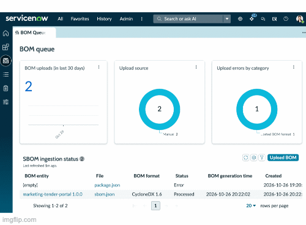

# Build Agent SBOM Exploration

**A research repository on the derivation of CycloneDX Software Bills of Materials from ServiceNow Build Agent project artefacts, and their ingestion into the ServiceNow SBOM Workspace.**

<p align="center">
  
</p>

| | |
|---|---|
| **Status** | Exploratory research — not a production component |
| **ServiceNow application** | Build Agent SBOM Exploration |
| **Subject artefact** | `package.json` of a Fluent SDK project |
| **Target artefact** | `sbom.json` (CycloneDX 1.6, JSON) |
| **Document revision** | October 2026 |

---

## Abstract

A ServiceNow Build Agent project is a Node.js project. It therefore carries a dependency manifest, `package.json`, which enumerates the third-party software upon which the application's construction depends. In parallel, the same platform hosts a Software Bill of Materials (SBOM) product capable of ingesting, analysing and remediating component-level supply chain risk. The two artefacts are adjacent but not connected: the manifest is not a bill of materials, and the SBOM product will not accept it.

This repository documents the gap, demonstrates that it is an *encoding* gap rather than a *semantic* one, and establishes a reproducible transformation pipeline — `package.json` → CycloneDX `sbom.json` → ServiceNow SBOM Workspace — automated through GitHub Actions. All platform-side assertions in this document were obtained by direct introspection of the installed applications and are labelled as primary observations.

---

## 1. Research objective

The investigation pursues four questions:

1. **Admissibility.** What classes of bill-of-materials document does the installed ServiceNow SBOM implementation accept, and under what validation contract?
2. **Equivalence.** Does the information contained in a Node.js dependency manifest satisfy that contract, and if not, what is materially absent?
3. **Transformation.** Can a standards-conformant SBOM be derived deterministically from a Build Agent project without manual curation?
4. **Autonomy.** Can that derivation be executed without human intervention on every build, and what are the boundaries of such autonomy?

The objective is explanatory, not prescriptive. The repository exists to make the mechanism legible and reproducible; it does not propose an organisational compliance programme.

---

## 2. Background: what a Software Bill of Materials is

An SBOM is a formal, machine-readable inventory of the software components and dependencies that constitute a software product, together with the hierarchical relationships between them. Its purpose is to render the software supply chain *interrogable*: given a newly disclosed vulnerability in a transitive dependency, an organisation holding SBOMs can determine its exposure by query rather than by investigation.

### 2.1 Minimum elements

The canonical baseline was established by the United States National Telecommunications and Information Administration in 2021, pursuant to Executive Order 14028 [1][2]. That baseline defined three dimensions:

- **Data fields** — supplier, component name, version, unique identifiers, dependency relationship, author of the SBOM, and timestamp.
- **Automation support** — machine-readable encoding in a recognised format, namely SPDX, CycloneDX, or SWID tags.
- **Practices and processes** — generation frequency, depth of the dependency tree, and explicit declaration of "known unknowns".

A 2026 revision published by CISA supersedes the 2021 baseline [3]. Two of its shifts bear directly on this research: the replacement of *depth* with **coverage** — transitive dependencies are expected in full, and omissions must be declared rather than left ambiguous — and the elevation of **generation context**, that is, the declaration of the lifecycle phase at which the SBOM was produced. A pre-build SBOM derived from a manifest and a post-build SBOM derived from a resolved artefact are not interchangeable evidence, and the standard now expects that distinction to be stated.

### 2.2 Regulatory drivers

SBOM production has moved from good practice to legal obligation. Regulation (EU) 2024/2847, the Cyber Resilience Act [4], requires manufacturers of products with digital elements to compile and maintain a machine-readable SBOM covering at minimum top-level dependencies, retained within the product's technical documentation and furnished to market surveillance authorities on reasoned request. The regulation's vulnerability-reporting obligations are already in force, with full compliance required by December 2027. It does not mandate a single format, requiring instead a commonly used machine-readable standard — in practice CycloneDX or SPDX.

### 2.3 Formats

Two formats dominate, and both are accepted by the platform under study:

- **CycloneDX** — developed by the OWASP Foundation and standardised as ECMA-424 [5][6]. Version 1.7 is current. The specification models not only components and dependency graphs but also services, vulnerabilities, compositions and formulation, and spans several bill-of-materials varieties beyond software alone (SaaSBOM, HBOM). Encodings: JSON, XML, Protocol Buffers.
- **SPDX** — a Linux Foundation project, standardised as ISO/IEC 5962:2021 [7], historically oriented toward licence compliance.

Component identity in both formats is carried by the **Package URL (PURL)** scheme [8], of the form `pkg:npm/lodash@4.17.21`. PURL is the join key on which downstream vulnerability correlation depends, and its correctness is the pivotal technical concern of Section 4.3.

---

## 3. The artefact under study: what a Build Agent project is

ServiceNow Build Agent, operating through the Fluent SDK, produces a *source-first* ServiceNow application: platform metadata is declared as TypeScript source and compiled into deployable artefacts. Structurally, the generated project is an ordinary npm package.

The scaffold of this repository, observed at creation, comprises:

```
now.config.json          Application identity: name, scope, sys_id
package.json             npm manifest — the artefact under study
src/server/tsconfig.json TypeScript configuration for server-side metadata
```

Its manifest declares two development dependencies:

| Dependency | Declared version | Form |
|---|---|---|
| `@servicenow/sdk` | `4.14.0` | exact |
| `@servicenow/glide` | `27.0.5` | exact |

Three properties of this manifest are material to the research:

1. **The dependency set is a build-time set.** A Fluent application's runtime executes inside the ServiceNow platform; the npm dependencies govern compilation and deployment. The resulting SBOM therefore describes the *toolchain* supply chain of the application, not its runtime composition. This is a legitimate and increasingly scrutinised attack surface — build tooling has been the vector of several significant supply chain compromises — but it must not be misrepresented as a runtime inventory.
2. **Versions are pinned exactly.** The scaffold declares no semantic-version ranges. As Section 4.3 establishes, this is precisely the condition under which derived PURLs remain valid, and it means a Build Agent project is unusually well-disposed toward correct SBOM derivation.
3. **The manifest declares direct dependencies only.** The transitive closure of `@servicenow/sdk` and `@servicenow/glide` is substantial and is not represented in the manifest at all.

---

## 4. The relationship, and the missing link

### 4.1 Statement of the gap

The platform under study hosts the following applications (primary observation, `sys_store_app`):

| Application | Scope | Version | Function |
|---|---|---|---|
| Data Model for SBOM | `sn_sbom_dm` | 4.3.1 | Tables for documents, components, dependencies |
| SBOM Core | `sn_sbom_core` | 6.5.1 | Ingestion, parsing, validation, queue |
| SBOM Response | `sn_sbom_resp` | 6.7.3 | Risk exposure, licence compliance, remediation |
| Vulnerability Response | `sn_vul` | 30.8.5 | Vulnerable item workflow |

Build Agent *emits* a dependency manifest. The SBOM product *consumes* a bill-of-materials document. The two are separated by a single missing transformation, and in its absence ingestion fails deterministically rather than degrading.

The missing link is not conceptual. The manifest already contains supplier-adjacent identity, component names and versions. What it lacks is the **document identity, the resolved dependency closure, and the standardised encoding** that the consuming system requires.

### 4.2 Empirical confirmation

Ingestion is governed by the `BOMValidationApi` script include (primary observation, scope `sn_sbom_core`). For a JSON payload it requires the presence of either a `bomFormat` key (CycloneDX) or an `spdxVersion` key (SPDX). A `package.json` possesses neither. The document is consequently rejected and persisted on `sn_sbom_doc` with:

```
queue_status    = error
error_category  = unsupported
status_reason   = "Unable to identify format of SBOM input."
```

This outcome was observed on this instance on a real upload attempt before the research began, which is how the investigation was motivated.

### 4.3 Three substantive deficits

Beyond encoding, the manifest is deficient in three respects whose consequences are measurable within the platform.

**(a) Absent document identity.** CycloneDX minimum fields enforced by the validator are `specVersion`, `version` (not required at spec 1.5), `metadata.component.name` and `metadata.component.type`. A manifest supplies no analogue of `metadata.component.type`, so the ingested document would have no declared subject even if the format were recognised.

**(b) Unresolved versions, and the PURL validity gate.** This is the most consequential finding. A manifest expresses dependencies as ranges, for example `^4.17.21`. A generator operating without a lock file or installed tree emits correspondingly unresolved PURLs, such as `pkg:npm/lodash@^4.17.21`.

The `PurlUtils.isValid()` routine requires the version segment of a PURL to be percent-encoded. The character `^` is not; `encodeURIComponent('^4.17.21')` yields `%5E4.17.21`, which does not match the raw segment. Validation therefore fails and the component is persisted with `is_purl_valid = false`.

That flag is a hard gate on enrichment. Both vulnerability intelligence integrations filter on it (primary observation):

- `OSVAPIIntegration` queries components with `is_purl_valid = true` and `source = SBOM`.
- `DepsAPIIntegration` restricts to ecosystems `golang, go, npm, cargo, maven, pypi, nuget` and requires a non-null base PURL.

An SBOM derived from an unresolved manifest thus produces an inventory that is syntactically ingested and analytically inert: components are listed, but no vulnerability, no fixability assessment, no staleness insight and no Vulnerable Item is ever generated from them. **The failure is silent**, which makes it more dangerous than outright rejection.

The ServiceNow scaffold's exact pinning (Section 3) avoids this failure mode by construction — but only if generation occurs against a resolved tree, since the pinned *direct* dependencies say nothing about transitive versions.

#### The gate is necessary but not sufficient

The behaviour of `PurlUtils.isValid()` was exercised directly against the instance. The results qualify the finding materially:

| Package URL | `isValid()` |
|---|---|
| `pkg:npm/%40servicenow/sdk@4.14.0` | `true` |
| `pkg:npm/%40servicenow/glide@27.0.5` | `true` |
| `pkg:npm/lodash@4.17.21` | `true` |
| `pkg:npm/lodash@^4.17.21` | `false` |
| `pkg:npm/lodash@%5E4.17.21` | `true` |
| `pkg:npm/lodash@~4.17.0` | `true` |
| `pkg:npm/lodash` | `true` |
| `npm/lodash@4.17.21` | `false` |

Three observations follow. First, the caret range is rejected, confirming the principal finding. Second, the **tilde range is accepted**, because `~` is an unreserved character that `encodeURIComponent` leaves untouched; the percent-encoding test therefore screens range operators only incidentally. Third, a **version-less PURL is accepted**, the version segment being optional in the specification.

Consequently `is_purl_valid = true` is a *necessary but not sufficient* condition for meaningful vulnerability correlation. A component bearing `pkg:npm/lodash@~4.17.0` passes the platform gate, enters the enrichment queries, and is correlated against an indeterminate target. The validation gate implemented in this repository is therefore deliberately **stricter than the platform**, rejecting ranges and absent versions irrespective of their percent-encoding.

The ServiceNow scaffold's exact pinning (Section 3) avoids this failure mode by construction — but only if generation occurs against a resolved tree, since the pinned *direct* dependencies say nothing about transitive versions.

**(c) Absent transitive closure.** The manifest describes direct dependencies only. The platform models dependency edges on `sn_sbom_comp_relationship`, distinguishing direct from indirect via `is_direct_dep` and recording resolution scope. Supply chain risk concentrates in the transitive tier; an SBOM without it satisfies the Cyber Resilience Act's top-level minimum while failing the coverage expectation of the 2026 CISA elements.

### 4.4 A version ceiling

One further constraint was identified by comparing the specification against the platform. `BOMParserApiDelegator` dispatches parsers by format, specification version and file type. Its mapping terminates at CycloneDX **1.6**; versions 1.0–1.4 route to a generic parser, 1.5 and 1.6 to dedicated ones. A document declaring **1.7** — the current specification version [5] — resolves to no parser and raises `Failed to get parsing API`.

The generator selected in Section 5 supports specification versions 1.2 through 1.6 and defaults to 1.6 [9], so the ceiling is respected by default. It is nonetheless pinned explicitly in this repository, because a future generator release defaulting to 1.7 would otherwise break ingestion silently from the platform's perspective.

---

## 5. Proposed solution: CycloneDX as transformer

The transformation is performed by `@cyclonedx/cyclonedx-npm` [9], the reference CycloneDX generator for the npm ecosystem. It interrogates npm for evidence of installed packages and emits a conformant CycloneDX document.

### 5.1 Canonical invocation

```bash
npm ci

npx --yes @cyclonedx/cyclonedx-npm@6.0.1 \
  --output-format JSON \
  --spec-version 1.6 \
  --output-file sbom.json \
  --mc-type application \
  --validate
```

Each option is deliberate:

| Option | Value | Rationale |
|---|---|---|
| `--output-format` | `JSON` | Accepted by the platform as `application/json`; XML is also admissible |
| `--spec-version` | `1.6` | The ceiling of the platform's parser dispatch table (Section 4.4) |
| `--output-file` | `sbom.json` | Deterministic artefact path for the downstream upload stage |
| `--mc-type` | `application` | Populates `metadata.component.type`, a validator-enforced minimum field |
| `--validate` | — | Validates against the CycloneDX schema before the document leaves the build |

`npm ci` is a precondition, not a convenience: it materialises the resolved dependency tree from the lock file, which is what supplies exact transitive versions and therefore valid PURLs. Generation without it reproduces deficit (b) of Section 4.3.

Two options are intentionally **not** adopted:

- `--package-lock-only` would derive the document from the lock file alone, forgoing evidence from the installed tree. It is a legitimate choice in constrained environments and remains correct with respect to versions, but it narrows the evidentiary basis.
- `--omit dev` would exclude development dependencies. For a Build Agent project this would exclude the *entire* dependency set, since `@servicenow/sdk` and `@servicenow/glide` are development dependencies. This is the decisive reason the research retains development dependencies, and it illustrates that the conventional "omit dev for production" heuristic inverts for build-tooling supply chains.

### 5.2 Mapping onto the ServiceNow data model

The transformation's output maps onto the installed data model as follows (primary observation of table schemas):

| npm / CycloneDX | ServiceNow |
|---|---|
| `component.name` | `sn_sbom_component.name` |
| scope `@servicenow` → `group` | `sn_sbom_component.group`, `namespace` |
| `component.version` | `sn_sbom_component.version` |
| `component.purl` | `sn_sbom_component.purl`, `is_purl_valid` |
| PURL type `npm` | `pkg_group.pkg_manager` (consumed by deps.dev) |
| `metadata.component` | `sn_sbom_doc.bom_entity` |
| `component.type` | `sn_sbom_component.type` |
| `licenses[]` | `sn_sbom_component.license`, `has_missing_licenses` |
| `dependencies[]` | `sn_sbom_comp_relationship` (`component` → `depends_on`, `is_direct_dep`) |
| `hashes[]` | `sn_sbom_component.hash_value`, `sn_sbom_comp_external_ref.hashes` |
| `externalReferences[]` | `sn_sbom_comp_external_ref` |
| unmapped fields | `sn_sbom_component.unprocessed_bom_data` |

Component `properties` are persisted only when the system property `sn_sbom_core.collect_properties` is enabled; it is `false` by default on the instance under study.

---

## 6. Integration: rendering the theory operational with GitHub Actions

The transformation of Section 5 must execute where the resolved dependency tree exists — on the build machine — and at the moment the tree is authoritative, which is every build. A continuous integration workflow is therefore the correct locus of automation, and this repository implements one.

### 6.1 Delivered artefacts

| Path | Function |
|---|---|
| `.github/workflows/sbom.yml` | Workflow: resolve, generate, validate, archive, publish |
| `scripts/validate-sbom.mjs` | Pre-upload conformance gate against the platform's ingestion contract |
| `scripts/upload-sbom.mjs` | Authenticated upload and terminal-state polling |

### 6.2 Workflow design

The workflow executes five stages on `push`, `pull_request` and manual dispatch:

1. **Resolve** — `npm ci` against the committed lock file. A guard step fails the run with an explanatory message if no lock file is present, since silent fallback to `npm install` would compromise version resolution and reintroduce the invalid-PURL failure mode.
2. **Generate** — the canonical invocation of Section 5.1, with the generator version pinned.
3. **Validate** — `scripts/validate-sbom.mjs` re-implements the platform's own admission criteria locally: format identification, minimum field presence, specification-version ceiling, and a faithful reproduction of `PurlUtils.isValid()`. The build fails on invalid PURLs. This is the mechanism by which the *silent* failure of Section 4.3(b) is converted into a *loud* one, at the only point where a human is still attending to the outcome.
4. **Archive** — `sbom.json` is retained as a build artefact, so that an SBOM exists for every build irrespective of the platform's availability.
5. **Publish** — upload to the instance, restricted to the default branch. Pull request runs generate and validate but do not publish, so that the platform's inventory reflects integrated code only.

### 6.3 Build metadata and provenance

The upload stage transmits build provenance through the parameters the ingestion API accepts. `requestedBy=devops` is used, which conditionally requires `buildId` and `lifecycleStage`; the former is bound to the CI run identifier and the latter is derived from the branch (`production` on the default branch, `pre_production` elsewhere). Non-production builds are retained up to the limit set by `sn_sbom_core.bom_max_build_limit`, observed as `10`, after which the oldest are reclaimed by the platform's scheduled cleanup.

### 6.4 Credentials

The workflow consumes a dedicated integration account holding only `sn_sbom_core.sbom_ingest`, the role that confers manual and REST upload capability and nothing further. Credentials are supplied as repository secrets and are never written to the workflow file or the repository.

| Name | Kind | Purpose |
|---|---|---|
| `SN_INSTANCE` | variable | Instance host name |
| `SN_BUSINESS_APP_ID` | variable | `sys_id` on `cmdb_ci_business_app` |
| `SN_SBOM_USER` | secret | Integration account |
| `SN_SBOM_PASSWORD` | secret | Integration account credential |

ServiceNow DevOps is **not** installed on the instance under study; the parameters above are accepted by the SBOM upload API independently of it. Were DevOps present, the same metadata would additionally support pipeline correlation and release gating.

---

## 7. Importing `sbom.json` into the ServiceNow SBOM Workspace

Two ingestion paths exist. Both terminate in the same queue and the same data model.

### 7.1 Interactive import

1. Navigate to the SBOM Workspace at `/now/sbom/home`.
2. Open **Upload SBOM** and attach `sbom.json`, associating the document with its business application or product model.
3. Observe the document in **BOM Queue**. A record is created on `sn_sbom_doc` with `queue_status = queued`; the scheduled job *Process next queued BOM* advances it to `processing` and then `processed`.
4. Inspect the result under **Components** and **Dependency graph**.

The uploading user requires `sn_sbom_core.sbom_ingest`.

### 7.2 Programmatic import

```bash
curl -X POST \
  "https://${SN_INSTANCE}/api/core/upload?businessApplicationId=${APP}&requestedBy=devops&buildId=${BUILD}&lifecycleStage=pre_production&fetchVulnerabilityInfo=true&fetchPackageInfo=true&fetchLicenseInfo=true&sbomSource=cyclonedx-npm" \
  -H "Content-Type: application/json" \
  -u "${SN_SBOM_USER}:${SN_SBOM_PASSWORD}" \
  --data-binary @sbom.json
```

The response returns `bomRecordId`, against which terminal state is polled:

```bash
curl "https://${SN_INSTANCE}/api/core/upload/status?bomRecordId=${ID}" \
  -u "${SN_SBOM_USER}:${SN_SBOM_PASSWORD}"
```

Queue states are `queued`, `processing`, `processed`, `error`, `skipped` and `timeout`. This is the path `scripts/upload-sbom.mjs` implements.

### 7.3 Post-import verification

Ingestion success is a necessary but insufficient condition for analytical value. The following should be confirmed in order:

1. `sn_sbom_doc` — `queue_status = processed`, `bom_format = CycloneDX`, `spec_version = 1.6`.
2. `sn_sbom_component` filtered on `is_purl_valid = false` — **must return no rows**. Any row indicates unresolved versions upstream and predicts silent enrichment failure.
3. `sn_sbom_comp_relationship` — rows with `is_direct_dep = false`, confirming transitive capture.
4. Enrichment — OSV runs daily and deps.dev weekly; on-demand triggers exist for both. Vulnerability counts populate only after a run completes.
5. **AVI creation rules** — the rule table `sn_sbom_config_rule` was observed **empty** on this instance. The daily job *Create AVIT through SBOM AVIT rules* executes, but in the absence of at least one rule no Vulnerable Item is ever created. Enrichment data will accumulate without producing remediation work. Configuring a rule requires `sn_sbom_resp.manage_avi_rule`.

Item 5 is the terminal gap in the chain and is recorded here as an open item rather than resolved, being a matter of organisational risk appetite rather than of mechanism.

---

## 8. Summary of findings

| # | Finding | Basis |
|---|---|---|
| 1 | The platform accepts CycloneDX (JSON, XML) and SPDX (JSON); no other encoding | `BOMConstants`, `BOMValidationApi` |
| 2 | A `package.json` is rejected deterministically as `unsupported` | Observed ingestion failure |
| 3 | Parser dispatch terminates at CycloneDX 1.6, while the specification is at 1.7 | `BOMParserApiDelegator`; [5] |
| 4 | Unresolved semantic-version ranges yield `is_purl_valid = false` | `PurlUtils.isValid()` |
| 5 | Invalid PURLs silently exclude components from all vulnerability enrichment | `OSVAPIIntegration`, `DepsAPIIntegration` |
| 6 | The validity gate rejects `^` ranges but admits `~` ranges and version-less PURLs | Executed against the instance |
| 7 | Build Agent scaffolds pin versions exactly, favouring correct derivation | `package.json` of this project |
| 8 | `--omit dev` would void a Build Agent SBOM entirely | `package.json` of this project |
| 9 | Without AVI creation rules, no remediation work is generated | `sn_sbom_config_rule` empty |

---

## 9. Scope and limitations

- The SBOM derived here describes the **build-time** dependency set of a ServiceNow Fluent application. It is not a runtime inventory of the platform, nor of the instance on which the application is deployed.
- Findings reflect one instance and the application versions enumerated in Section 4.1. Parser dispatch tables and validation routines are implementation details of those versions and may change.
- No assertion is made regarding the sufficiency of this pipeline for compliance with any regulatory instrument. Sections 2.1 and 2.2 are included as context for *why* the mechanism matters, not as a compliance mapping.
- The 2026 revision of the minimum elements [3] introduces expectations — notably SBOM author signatures and hashes of executable artefacts — that the pipeline described here does not address.

---

## 10. Repository layout

```
.
├── README.md                      This research document
├── now.config.json                ServiceNow application identity
├── package.json                   Subject artefact and SDK manifest
├── sbom_example.json              Ingested specimen: marketing-tender-portal 1.0.0
├── .github/
│   └── workflows/
│       └── sbom.yml               CI: resolve, generate, validate, archive, publish
├── docs/
│   ├── images/
│   │   └── product_visual.gif     Animated overview (Appendix B.1)
│   └── screenshots/               Stills referenced in Appendix B.2
├── scripts/
│   ├── validate-sbom.mjs          Ingestion-contract conformance gate
│   ├── upload-sbom.mjs            Authenticated upload and status polling
│   └── fixtures/
│       └── create-business-application.js   CMDB fixture (Appendix A)
└── src/
    └── server/                    Fluent metadata (unused in this study)
```

---

## 11. References

[1] Executive Order 14028, *Improving the Nation's Cybersecurity*, 12 May 2021. https://www.federalregister.gov/d/2021-10460

[2] National Telecommunications and Information Administration, *The Minimum Elements For a Software Bill of Materials (SBOM)*, 12 July 2021. https://www.ntia.gov/report/2021/minimum-elements-software-bill-materials-sbom

[3] Cybersecurity and Infrastructure Security Agency, *Software Bill of Materials* resource hub, including the 2026 revision of the minimum elements. https://www.cisa.gov/sbom

[4] Regulation (EU) 2024/2847 of the European Parliament and of the Council (Cyber Resilience Act). https://eur-lex.europa.eu/eli/reg/2024/2847/oj

[5] OWASP Foundation, *CycloneDX Specification Overview*, version 1.7. https://cyclonedx.org/specification/overview/

[6] Ecma International, *ECMA-424: CycloneDX Bill of Materials Specification*. https://ecma-international.org/publications-and-standards/standards/ecma-424/

[7] The Linux Foundation, *SPDX*, standardised as ISO/IEC 5962:2021. https://spdx.dev/

[8] *Package URL (PURL) specification*. https://github.com/package-url/purl-spec

[9] CycloneDX, *cyclonedx-node-npm* generator. https://github.com/CycloneDX/cyclonedx-node-npm

[10] *Open Source Vulnerabilities (OSV)*. https://osv.dev/

[11] *Open Source Insights (deps.dev)*. https://deps.dev/

Primary observations were obtained by introspection of the installed scoped applications `sn_sbom_dm`, `sn_sbom_core` and `sn_sbom_resp`, and are attributed inline to the specific script include, table or system property from which they derive.

---

## Appendix A — Experimental fixture

The figures in Appendix B were captured against a controlled specimen rather than against production data. The specimen comprises two artefacts.

### A.1 The ingested document

`sbom_example.json` is a CycloneDX 1.6 document describing **`marketing-tender-portal` 1.0.0**, a Node.js application of representative size. On ingestion it produced:

| Measure | Value |
|---|---|
| Document | `SBOM0001003` |
| Format and specification | CycloneDX 1.6, JSON |
| Queue status | `processed` |
| BOM UUID | `urn:uuid:c611a1aa-6e3f-4686-988b-c024f5abe2b5` |
| BOM entity | `marketing-tender-portal 1.0.0`, `pkg:npm/marketing-tender-portal@1.0.0` |
| Distinct component records | 466 |
| Dependency edges | 1,710 (1,245 direct, 465 indirect) |
| Components with `is_purl_valid = false` | **0** |

The final row is the material one. It is the empirical counterpart of Section 4.3(b): generation against a resolved dependency tree yields a document in which every component is eligible for vulnerability enrichment. The specimen is therefore a positive control, and any future specimen exhibiting a non-zero count in that row should be regarded as defective rather than merely incomplete.

### A.2 The configuration item

A bill of materials acquires analytical meaning only when bound to something the organisation owns. `scripts/fixtures/create-business-application.js` creates that binding: a Business Application on `cmdb_ci_business_app`, to which the BOM entity is then attached through its `business_app` reference.

The script runs as a background script in the **global** scope. It writes one configuration item and updates one field on one SBOM component; it creates no metadata. It is idempotent, so re-running it refreshes the record rather than cloning it.

Resulting record:

| Field | Value |
|---|---|
| Number | `APM0001001` |
| Name | Marketing Tender Portal |
| Status | In Production |
| Operational status | Operational |
| Business criticality | High |
| Data classification | Confidential |
| Emergency tier | Business critical |
| Application type | Homegrown |
| Architecture / stack | Web Based / MERN |
| Platform / install type | AWS / Cloud |
| Environment | Production |
| Audience type | Business to Business |
| User base / active users | 500–999 / 742 |
| Annual cost | 185,000 EUR |
| Attestation | Attested, score 92 |
| Correlation ID | `pkg:npm/marketing-tender-portal@1.0.0` |

Two conventions in the fixture warrant explanation, since both are deliberate and both affect how the figures should be read.

**Correlation by Package URL.** The configuration item's `correlation_id` carries the PURL of the BOM entity. The CMDB and the SBOM are thereby joined on the same identifier the bill of materials itself uses, rather than on a name match. This is a modest but useful property: it makes the binding verifiable rather than merely asserted.

**Empty fields are preferred to approximate ones.** Reference fields are resolved by name with fallbacks, because demo data differs between instances. Where no coherent value exists, the field is left blank. On the instance of record this affected three fields: `cost_center`, because `cmn_cost_center` contains no rows; and `company` together with `manufacturer`, because the instance declares no primary company and the only available records describe external software vendors — which would contradict the application's `homegrown` classification. A blank field in a figure is an honest absence; a plausible-looking wrong one is a false datum that a reader cannot detect.

### A.3 Reproducing the fixture

1. Ingest `sbom_example.json` through the SBOM Workspace or the upload API (Section 7) and wait for `queue_status = processed`.
2. Read the resulting BOM entity `sys_id` from `sn_sbom_doc.bom_entity` and set the `BOM_ENTITY` constant in the fixture script. A new entity record is created on each ingestion, so this constant is specific to a run.
3. Execute the script in the global scope and confirm from its report that the binding took effect.
